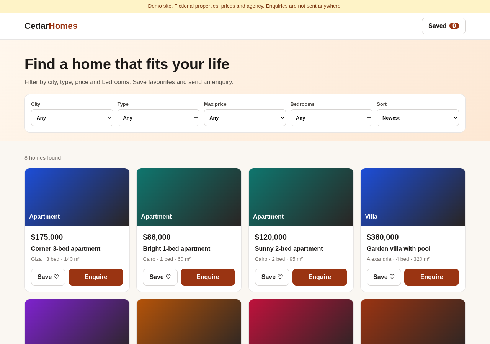

# Cedar Homes (property listing demo)

_Screenshot (local test run, fictional demo data)._

Property listing site with filters, sorting, saved homes and an enquiry form.

**Demo project.** All businesses, products, people and numbers are fictional. Nothing is sent anywhere and no real data is collected.

## What it does
- Filter by city, type, max price, bedrooms; sort by price or newest
- Save homes (kept in the browser) and view only saved ones
- Enquiry dialog with validation; shows a demo notice and sends nothing
- Browser-tested: filters, sort, empty state, save persistence, form validation

## Run it
No build step. Open `index.html` in a browser, or serve the folder: `python3 -m http.server 8000`.

## Stack
HTML, CSS and plain JavaScript. No frameworks.

Built by Mahamed Yasser.
